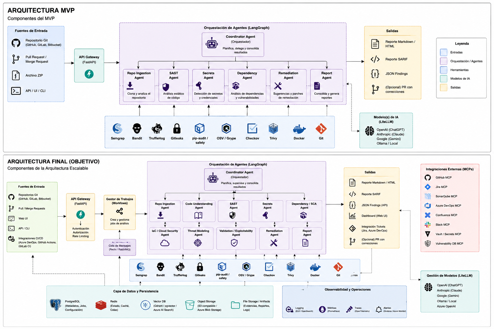

# Governed AI Code Security

> **Status: proof of concept (v0.1.0).** This is a prototype built to explore how LLM agents and
> specialized security scanners can work together in a CI pipeline. It is not a production
> product. See [What is real and what is not](#what-is-real-and-what-is-not).

Governed, AI-assisted source-code security analysis. A FastAPI service runs a LangGraph workflow over a
source repository: specialized scanners find issues, their output is normalized into typed
findings, and an LLM (any provider, via LiteLLM) triages, explains and proposes fixes. Results
come out as JSON, Markdown, CSV and SARIF, ready for CI gates and GitHub code scanning.

It runs fully offline with no API keys using a deterministic **mock model mode**, so you can
try the whole pipeline in minutes.



## Why

Scanners are precise but noisy and say nothing about business impact. LLMs reason well about
context but hallucinate and miss things deterministic tools catch. This project combines them:
**tools produce the evidence, the model interprets it**, and every model call is capped,
redacted of secrets, logged and traced.

## How it works

```
Client / CI -> FastAPI -> Coordinator -> LangGraph:
  repo_ingestion -> sast -> secrets -> dependency -> cicd -> remediation -> report
-> Persistence (SQLite / Postgres) -> Reports (JSON / Markdown / CSV / SARIF)
```

| Stage | Scanners | LLM role (when enabled) |
|---|---|---|
| `sast` | Semgrep, Bandit, Meziantou analyzers | Triage of the most severe findings |
| `secrets` | Gitleaks, TruffleHog | Placeholder vs. live-credential classification |
| `dependency` | pip-audit, OSV-Scanner, Trivy, Checkov (+ Databricks bundle rules) | Exploitability and business-impact notes |
| `cicd` | Poutine (CI/CD workflow weaknesses) | none |
| `remediation` | – | Patch suggestions for critical/high findings |
| `report` | – | Executive summary |

Scanners that are not installed are skipped with a warning rather than failing the run.
Design details: [architecture](docs/architecture.md), [model strategy](docs/model_strategy.md),
[observability](docs/observability.md), [extension points](docs/extension_points.md).

## Quick start (Docker)

The Docker stack includes the app, Postgres, Redis, an OpenTelemetry collector, Prometheus,
Grafana, Loki and Tempo. These are bundled so the prototype can be evaluated end to end;
they are not a production deployment.

```bash
cp .env.example .env
make docker-up        # API on http://localhost:8001 (docs at /docs), Grafana on :3001
make analyze-sample   # scans the bundled intentionally-vulnerable fixture
make docker-down
```

Grafana: http://localhost:3001 (admin/admin, anonymous viewer enabled), Prometheus: http://localhost:9090.
To scan your own code, put it under `./scan-targets/<repo>` (or set `SCAN_TARGETS_DIR`) and
submit `local_path: "/scan-targets/<repo>"`.

## Quick start (local)

Requires Python 3.11+.

```bash
python3 -m venv .venv && source .venv/bin/activate
make install
make run              # http://localhost:8000, SQLite, mock models
```

```bash
curl -X POST http://localhost:8000/api/v1/analysis \
  -H "Content-Type: application/json" \
  -d '{"local_path": "tests/fixtures/sample_vulnerable_repo", "enable_remediation": true}'
# => {"analysis_id": "...", "status": "queued"}

curl http://localhost:8000/api/v1/analysis/<id>/status
curl http://localhost:8000/api/v1/analysis/<id>/findings
curl http://localhost:8000/api/v1/analysis/<id>/reports/markdown   # also json, sarif, csv, csv-deduplicated
```

Pass `repo_url` and `branch` instead of `local_path` to clone a remote repository. Install any of
`semgrep`, `bandit`, `gitleaks`, `trufflehog`, `pip-audit`, `osv-scanner`, `trivy`, `checkov`,
`poutine` for fuller coverage (the Docker image bundles most of them).

## Using it in CI

[scripts/ci_scan.py](scripts/ci_scan.py) submits a scan, waits for it, optionally saves the SARIF
report and fails the build when findings reach a severity threshold:

```bash
python scripts/ci_scan.py --url http://localhost:8001 --local-path /scan-targets/my-repo \
  --fail-on high --sarif-out results.sarif
```

Exit codes: `0` gate passed, `1` findings at or above `--fail-on`, `2` analysis failed, timed
out, or **no scanner was available** (an empty result from zero scanners is never reported as
clean). A complete GitHub Actions example, including SARIF upload to code scanning, is in
[examples/github-actions/security-scan.yml](examples/github-actions/security-scan.yml).

## Using a real LLM

By default `MODEL_MOCK_MODE=true` and no key is needed. To use a provider, set its key in `.env`
(`ANTHROPIC_API_KEY`, `OPENAI_API_KEY`, `GOOGLE_API_KEY`, `AZURE_OPENAI_*`, or `OLLAMA_BASE_URL`
for a local model), set `MODEL_MOCK_MODE=false`, and choose a `model_profile` in the request
(`default`, `openai`, `gemini`, `azure`, `local-ollama`, `mock`). Profiles map five roles
(coordinator, analysis, remediation, reporting, cheap classifier) to concrete models in
[configs/models.yaml](configs/models.yaml); check that the model names there match what your
provider currently offers.

**Data handling:** code snippets are sent to the configured provider. Secrets are redacted
before any prompt leaves the process, but redaction is pattern-based and not a guarantee. Use
the `local-ollama` profile if code must not leave your environment.

## What is real and what is not

Implemented and tested:

- FastAPI gateway, LangGraph coordinator with seven nodes and a short-circuit on ingestion failure.
- Seven working agents on a common `BaseAgent`, eight-plus scanner adapters behind a `ToolRunner`.
- LiteLLM model client with role-based routing, retries, cost estimates and secret redaction.
- Typed Pydantic contracts, async SQLAlchemy persistence (SQLite / Postgres).
- JSON, Markdown, CSV and SARIF-shaped reports.
- OpenTelemetry traces, Prometheus metrics, structured logs and a Grafana dashboard.
- 68 unit and integration tests run in CI.

Scaffolded only (interfaces and placeholders, no working implementation):

- MCP integrations (GitHub, Azure DevOps, Jira, SonarQube, vulnerability DB, Vault).
- Four future agents: code understanding, IaC/cloud, threat modeling, validation.
- Real vector store / RAG backends, S3 and Azure Blob object storage.
- Authentication, authorization and rate limiting.
- Cloud deployment (`infra/aws`, `infra/azure` are placeholders).
- Durable job queue (the PoC uses FastAPI background tasks) and graph checkpointing.

## Known limitations

- **The model does not read your source files.** Today the LLM only comments on what scanners
  report (snippets, package names, finding titles). It does not independently discover
  vulnerabilities. A code-review agent that reads files is the main planned next step.
- LLM enrichment is deliberately capped (top 5 findings for analysis, 10 for remediation) to
  bound cost, and its output is stored as free text rather than a validated schema.
- The SARIF report is SARIF 2.1.0-shaped, not validated against the full schema.
- OSV-Scanner severity is not parsed from CVSS vectors; it falls back to a default.
- `mypy` reports known typing debt (CI runs it as non-blocking).
- No job queue: concurrent analyses share one process.
- AI output can be wrong. Treat findings and suggested patches as input for human review.

## License

Apache-2.0, see [LICENSE](LICENSE) and [NOTICE](NOTICE).

## Development

```bash
make test    # pytest
make lint    # ruff + mypy
```

See [CONTRIBUTING.md](CONTRIBUTING.md). To report a vulnerability in this project, see
[SECURITY.md](SECURITY.md).

## Repository layout

```
app/            api, agents, orchestration (LangGraph), models (LiteLLM), tools (scanner adapters),
                mcp, langchain_utils, persistence, reports, observability, core
configs/        app, models, tools and observability configuration, custom Semgrep rules
infra/          observability stack configs; AWS/Azure placeholders
docs/           architecture, strategies, diagrams, example reports
scripts/        CI client
examples/       GitHub Actions workflow
tests/          unit and integration tests, intentionally vulnerable fixture repo
```

The files under `tests/fixtures/sample_vulnerable_repo` are intentionally insecure and exist only
as scan targets. Never deploy them.
